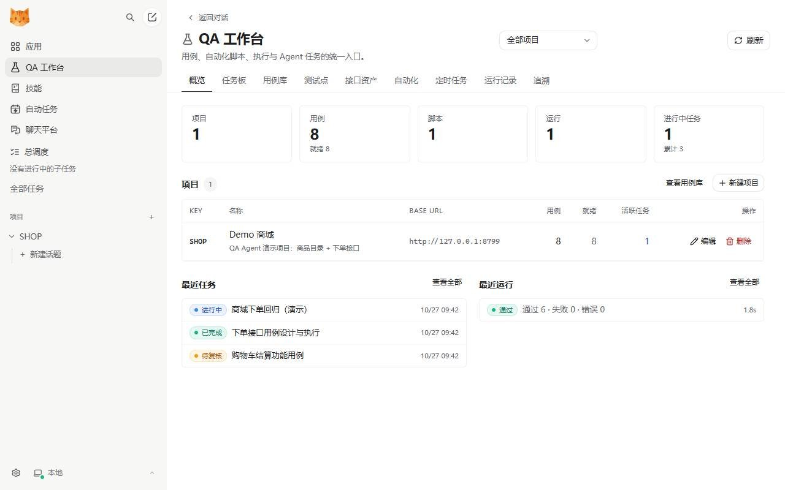
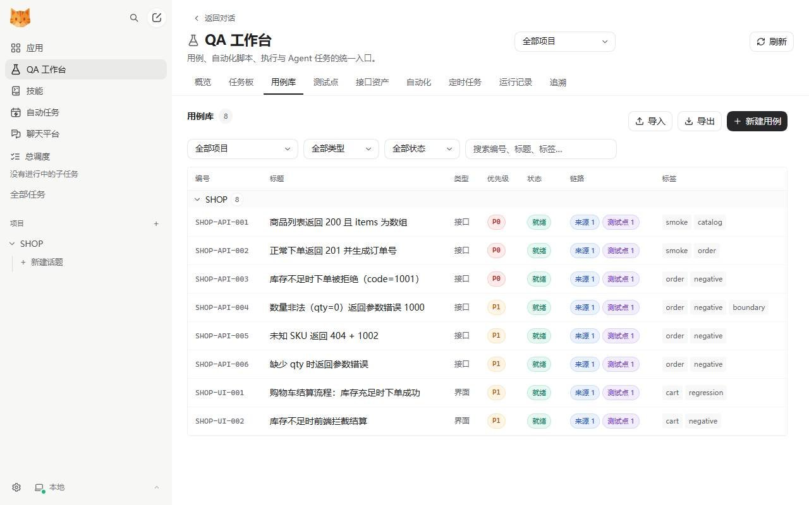
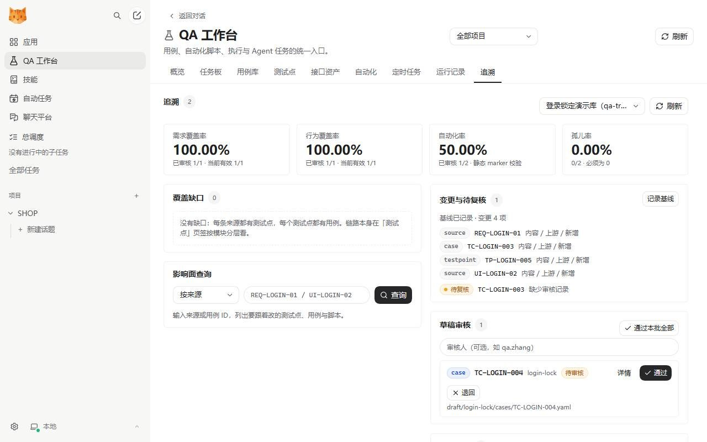
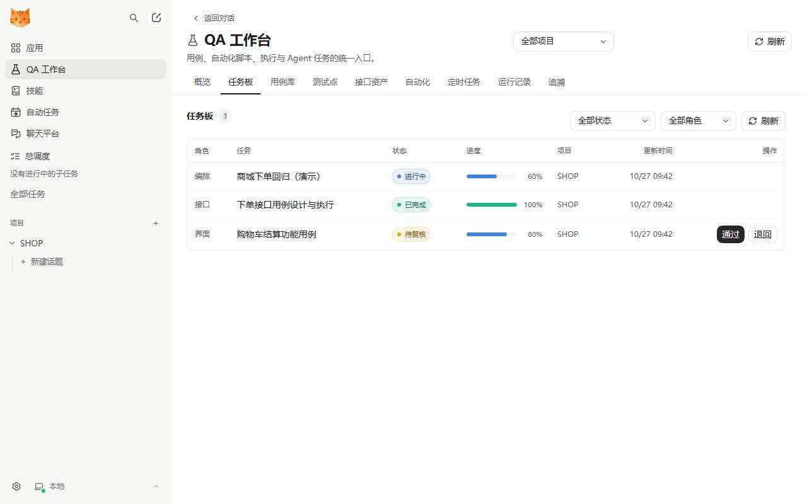

<p align="center">
  
</p>

<h1 align="center">QA Agent</h1>

<p align="center">
  <b>Turn test work into structured data: cases, scripts, runs, traceability and dispatch in one workbench.</b><br>
  A test-work fork of <a href="https://github.com/HKUDS/nanobot">nanobot</a>
</p>

<p align="center">
  <a href="./LICENSE"></a>
  
  
</p>

<p align="center">
  <b>English</b> · <a href="./README.CN.md">简体中文</a>
</p>

<p align="center">
  <a href="./docs/images/qa-workbench-overview.jpg"></a>
</p>

## Contents

- [What this is](#what-this-is)
- [Features](#features)
- [Screenshots](#screenshots)
- [Architecture](#architecture)
- [Quick start](#quick-start)
- [Using it in chat](#using-it-in-chat)
- [Data model](#data-model)
- [CLI](#cli)
- [Integrations](#integrations)
- [Repository layout](#repository-layout)
- [Docs](#docs)
- [Development and testing](#development-and-testing)
- [Known limitations](#known-limitations)
- [Credits and license](#credits-and-license)

## What this is

QA Agent is not another chatbot that claims to "do testing". It keeps nanobot's runtime — model access, sessions, tools, skills, MCP, WebUI — and adds the scaffolding test work actually needs:

- **Dispatch.** The lead assistant splits one sentence into a task tree and hands API, functional, automation and review work to specialist subagents. Progress, artifacts and review verdicts land on the task board.
- **Durable artifacts.** Cases, scripts, runs, test points and requirement sources carry IDs, statuses and project ownership instead of living in chat logs.
- **Reproducible execution.** API cases carry a structured request and typed assertions and run through a fixed executor; pytest scripts run in a subprocess. Every run leaves a report, a case snapshot and a failure classification.
- **Traceability.** Requirement → test point → case → script is a queryable chain: it answers "which requirement does this failure cover?" and "what does changing this requirement break?"
- **The model only decides.** Designing cases and reading failures is the model's job; writes, execution and review go through fixed tool contracts, so the output shape cannot drift between runs.

In one line: **the model thinks, the platform records and runs.**

## Features

### One workbench, nine tabs

The UI ships in Simplified Chinese; tab names below are shown as they appear, with an English gloss.

| Tab | What it does |
|---|---|
| 概览 Overview | Counts for projects, cases, scripts, runs and active tasks; recent tasks and runs |
| 任务板 Task board | Dispatched tasks by role: status, progress, review (approve / send back) |
| 用例库 Case library | Create, edit, filter, import and export structured cases; badges show source / test point / script / needs-recheck |
| 测试点 Test points | Requirement-to-test-point coverage, pending drafts, cases that still have no chain |
| 接口资产 API assets | Endpoint catalog ingested from OpenAPI or registered paths: method, path, summary, linked case count, change status |
| 自动化 Automation | pytest / Playwright / Postman / HTTP / Karate scripts and their case bindings |
| 定时任务 Schedules | Cron-triggered runs of a case set or a script, with time zone and run-now |
| 运行记录 Runs | Per-run pass / fail / error / blocked_by_env detail, case snapshots, failure classification, JUnit import |
| 追溯 Trace | Coverage metrics, coverage gaps, impact queries, change and re-check, draft review, failure tracing |

### A lead assistant splits the work

The lead assistant in a chat does not write cases itself. It splits the request first, then dispatches. Five roles have fixed prompts and completion contracts in `nanobot/qa/roles.py` (`orchestrator` dispatches; the other four are the workers):

| Role | Owns | Produces |
|---|---|---|
| `orchestrator` | Intake, splitting, dispatch, summary | Task tree, conclusion, open risks |
| `api` | API case design and execution | API cases + run + defect summary |
| `ui` | Functional test points and stepwise cases | UI / manual cases |
| `automation` | Cases → pytest / Playwright scripts | Scripts + runs |
| `review` | Coverage, assertion strength, environment misjudgement | Review verdict + additional cases |

Five bundled skills keep output from drifting: `qa-orchestrator` (splitting and dispatch templates), `qa-api-testing` (the API case matrix and `api` field shapes), `qa-functional-testing` (requirement → test points → steps), `qa-automation` (script templates and repair discipline), `qa-report` (failure classification and defect summaries).

### Cases are data, not chat logs

The case library keeps **YAML files as the source of truth**; SQLite is only the index used for listing and search:

- Formal cases live in `qa-workbench/projects/<project>/cases/`. New cases start in `draft/<batch>/cases/`, and deleting writes a `tombstones/` file, so the ID retires and is never reused.
- A case carries `code` (e.g. `SHOP-API-001`), `kind` (api / ui / manual), `priority` (P0–P3) and `status` (draft / ready / deprecated).
- For API cases, `api.request` plus `api.assertions` is public API; adding an assertion type means changing validation, the runner, the skill and the editor together.
- Badges in the list say exactly what a case is missing: no source, no test point, needs re-check, or still in the draft area.

### API testing is a fixed pipeline

API work is not "let the model fire requests and hope":

1. `qa_api_catalog` registers API reference material (OpenAPI / JSON / YAML; local files are only read under `NANOBOT_QA_SPEC_ROOTS`) and diffs it against the previous version.
2. `qa_api_workflow` stages a candidate case batch, validates it, then applies it in one transaction; every case write records a revision.
3. `qa_api_run` runs `preflight` to report everything that would block execution, then `start`: fixed template, case snapshot, automatic batching above 200 cases (2,000 per run at most), credential masking (bearer, JSON login, `env:NAME` references).
4. Cases pass values with `api.extract` and `{{run.<name>}}`. A failed login is classified `auth_failed`, a failed cleanup step `cleanup_failed`, and a failed setup step marks the cases phase `dependency_blocked`.

Run statuses: `running`, `passed`, `failed`, `error`, `blocked_by_env`, `cancelled`. **`blocked_by_env` exists for environment problems** (unreachable host, timeouts) so they never count as product defects.

### Traceability: a failure leads back to a requirement

Trace turns "which requirement does this failure cover, what does changing a requirement break, which cases are dead weight" into a single query:

- The data stays YAML-first: `sources/` (requirement, API, UI, bug, standard, observation), `testpoints/`, `cases/`, `scripts/`, `artifacts/` (evidence) and `runs/` (real run manifests written by the pytest plugin).
- Four metrics are reported separately: requirement coverage, behaviour coverage, automation rate and orphan rate; `trace check` validates document and graph rules.
- In the workbench you can query impact (by source, test point or case), review changes and re-checks (record a baseline), approve or reject drafts (single or a whole batch), and trace a failed run back to its requirement.
- CI gate: `qa trace diff --project <path> --base <git-ref>` materialises the project subtree from the base commit into a temp directory and compares both sides. Exit codes: `0` no regression, `1` regression, `2` bad input.

### Runs, reports and schedules

- A run is a first-class object with `name`, `environment`, `trigger` (manual / ci / agent / schedule) and per-case assertion detail.
- CI results arrive three ways: `nanobot qa import-junit`, the agent tool `qa_run action=import`, or "Runs → Import JUnit" in the workbench.
- Schedules run a case set or a script on a cron expression with a time zone; the gateway scheduler claims and executes each occurrence, and `run_now` runs one immediately.

### One implementation, many entry points

The WebUI, the chat tools, the CLI and the MCP server share one store and one execution path: a project created in the UI is visible in chat, and a run started from the CLI shows up in the workbench.

## Screenshots

<p align="center">
  
</p>

<p align="center"><sub>Case library: structured cases with source / test point / script / needs-recheck badges</sub></p>

<p align="center">
  
</p>

<p align="center"><sub>Trace: four coverage metrics, coverage gaps, impact query and draft review</sub></p>

<p align="center">
  
</p>

<p align="center"><sub>Task board: role, status, progress and human review</sub></p>

## Architecture

```text
WebUI workbench
  |  read:  GET /api/qa/*        write: WS qa.* mutation
  v
nanobot/qa/http.py
  +-- cases / scripts / runs / tasks / schedules --> store.py (SQLite)
  |                                                     +--> case_files.py --> YAML case library
  +-- trace --------------------------------------> trace_api.py --> qa_trace
                                                                    +--> qa-workbench/projects/

Lead assistant (chat) -- qa_* tools --> nanobot/agent/tools/qa.py --> the same services
      +-- qa_task action=plan --> SubagentManager --> api / ui / automation / review assistants
MCP client -- stdio --> nanobot/qa/mcp_server.py --> the same tool implementations
```

| Concern | Code |
|---|---|
| QA persistence (projects / scripts / runs / schedules / tasks / event log) | `nanobot/qa/store.py` |
| YAML case-library adapter (write file first, index second, tombstones, chain badges) | `nanobot/qa/case_files.py` |
| Case and API contract validation | `nanobot/qa/validation.py` |
| Structured API case executor (httpx, evaluates assertions itself, no model involved) | `nanobot/qa/runner.py` |
| Fixed pipeline execution (preflight, snapshot, batching, masking, classification) | `nanobot/qa/execution.py`, `nanobot/qa/service.py` |
| `/api/qa/*` reads plus the WebSocket write channel | `nanobot/qa/http.py` |
| Trace adapter (read routes plus 3 review mutations) | `nanobot/qa/trace_api.py` |
| API catalog and candidate batches | `nanobot/qa/catalog.py`, `nanobot/qa/api_tools.py` |
| Test point / source draft writes | `nanobot/qa/testpoints.py` |
| Background scheduling (schedules, background runs) | `nanobot/qa/scheduler.py`, `nanobot/qa/run_queue.py` |
| Role prompts and completion contracts | `nanobot/qa/roles.py` |
| Model-facing tools | `nanobot/agent/tools/qa.py`, `qa_api.py`, `qa_testpoint.py` |
| MCP stdio server | `nanobot/qa/mcp_server.py` |
| Trace domain library and CLI | `qa_trace/` |

Deeper boundaries and trade-offs live in [`docs/design/qa-platform.md`](./docs/design/qa-platform.md), [`docs/design/qa-trace.md`](./docs/design/qa-trace.md) and [`docs/adr/`](./docs/adr/).

## Quick start

### Requirements

- **Python 3.11+** (the deployment host runs 3.12)
- **Node.js 22 + npm**, only to build the WebUI (`nanobot/web/dist` is not in git)
- A model provider (OpenAI-compatible API, Anthropic, a local model, and so on — see [`docs/providers.md`](./docs/providers.md))

### Install from source

```bash
git clone git@github.com:NanNnnn0/qa-agent.git    # private repository, needs the matching SSH key
cd qa-agent

python -m venv .venv
source .venv/bin/activate            # Windows: .venv\Scripts\Activate.ps1

pip install -e ".[dev]"

# Build the WebUI (once; rerun after frontend changes)
cd webui && npm install && npm run build && cd ..
```

> `pip install -e` skips the frontend build, and neither `.venv/` nor `nanobot/web/dist/` is in git. **A fresh clone is not a working install** until both steps above have run.

### Five-minute demo

```bash
# 1) Write demo data: a shop project, 6 API cases, 2 functional cases, 1 pytest script and dispatch tasks
nanobot qa seed

# 2) Terminal A: start the demo shop API under test (http://127.0.0.1:8799)
nanobot qa demo-server

# 3) Terminal B: run the API cases and print the report
nanobot qa run --project SHOP --kind api

# 4) Start the gateway and open http://127.0.0.1:8765 → "QA 工作台" in the sidebar
nanobot gateway
```

Configure a model with `nanobot onboard`, or in the WebUI under **设置 → 模型**.

You can skip the demo data: `nanobot qa status` prints the database location, and `nanobot qa projects` / `cases` / `tasks` list what is there. The database defaults to `<config-dir>/qa/qa.sqlite3`; point `NANOBOT_QA_DB` somewhere else to move it.

### Trace demo

```bash
# Validate the demo project (login-lock: requirement → test point → case → script; the script assertion fails on purpose)
python -m qa_trace trace check  --project qa-workbench/projects/login-lock
python -m qa_trace trace report --project qa-workbench/projects/login-lock

# Run a real pytest session; the run manifest is written into the project's runs/
python -m pytest -p qa_trace.pytest_plugin \
  --qa-project=qa-workbench/projects/login-lock \
  qa-workbench/projects/login-lock/scripts/test_login.py -q

# Failure tracing / impact / changes / drafts
python -m qa_trace trace failure --project qa-workbench/projects/login-lock --run <run-id>
python -m qa_trace trace impact  --project qa-workbench/projects/login-lock --source REQ-LOGIN-01
python -m qa_trace trace stale   --project qa-workbench/projects/login-lock
python -m qa_trace trace review list --project qa-workbench/projects/login-lock
```

The trace project root defaults to the repository's `qa-workbench/projects`; set `NANOBOT_QA_TRACE_ROOT` to point elsewhere (do so explicitly when deploying from a wheel).

## Using it in chat

Open a topic and describe the test goal:

> Run an order-API regression on project SHOP: happy path, out of stock, invalid parameters, unknown SKU. Execute it and give me a conclusion.

The lead assistant runs `qa_overview` → `qa_project action=get` → `qa_task action=plan` (one role each for API, functional and automation), then the background assistants write cases, execute and report back. The task board shows each task moving `queued` → `running` → `needs_review` / `done`, together with its artifacts.

When a task needs a human decision it stops at `needs_review`. Approve or send it back with a note: approve → `done`, send back → `failed`; both write the reviewer and verdict into the task result and the event log.

## Data model

| Object | Key fields |
|---|---|
| project | `key` (case-code prefix), `name`, `base_url`, `repo_path` |
| case | `code`, `kind`, `priority`, `status`, `steps`, `api{request,assertions}`, `testpoints`, `sources` |
| script | `framework`, `file_path`, `content`, `case_ids` |
| run | `status`, `trigger`, `environment`, per-case assertion detail, case snapshot |
| task | `role`, `status`, `progress`, `subagent_task_id`, event log (created / status / dispatched / artifact / plan) |
| schedule | `cron`, `timezone`, `target` (case set or script), `next_run_at`, `last_status` |
| trace | `source` (req / api / ui / bug / std / ex), `testpoint`, `case`, `script`, `evidence` |

Trace data directory (YAML is the source of truth; the index and run records are derived):

```text
qa-workbench/projects/<project>/
├── project.yaml            # project metadata and thresholds
├── sources/                # REQ-* / API-* / UI-* … (chain roots, evidence required)
├── testpoints/             # TP-*
├── cases/                  # TC-* (linked to a test point, or to a source with a direct_reason)
├── draft/<batch>/          # pending drafts, excluded from coverage
├── tombstones/             # a delete is a tombstone
├── scripts/                # pytest scripts
├── artifacts/              # requirement copies, screenshots, captures
└── runs/<run-id>/manifest.json
```

## CLI

| Command | Purpose |
|---|---|
| `nanobot qa status` | Database path and headline counts |
| `nanobot qa seed` | Write the demo project, cases, script and dispatch tasks |
| `nanobot qa demo-server` | Start the demo shop API (with out-of-stock and bad-parameter branches) |
| `nanobot qa projects` / `cases` / `tasks` | List projects / cases / tasks |
| `nanobot qa run --project SHOP --kind api` | Execute a case set (also `--case`, `--script`) |
| `nanobot qa import-junit --project SHOP --file report.xml` | Import a CI JUnit report as a run |
| `nanobot qa reindex [--project SHOP]` | Rebuild the SQLite index from the YAML case library |
| `nanobot qa mcp` | Start the MCP server over stdio |

Trace and migration (the `qa_trace` package):

| Command | Purpose |
|---|---|
| `python -m qa_trace trace check` | Validate the document and graph rules of a project library |
| `python -m qa_trace trace report` | Coverage, gaps and dead assets |
| `python -m qa_trace trace diff --base <git-ref>` | Compare against a baseline and gate on regressions |
| `python -m qa_trace trace impact` | Everything below a source, test point or case |
| `python -m qa_trace trace stale` | Compare content and dependency hashes against the baseline |
| `python -m qa_trace trace failure --run <id>` | Trace a run's failures back onto the chain |
| `python -m qa_trace trace draft new/add` | Write draft entities (agent-facing) |
| `python -m qa_trace trace review list/approve/reject` | List, approve or reject drafts |
| `python -m qa_trace trace migrate-sqlite` | Export legacy SQLite cases as YAML drafts (read-only, repeatable) |

## Integrations

### MCP

External MCP clients can reuse the same tools and the same database:

```json
{
  "tools": {
    "mcpServers": {
      "qa": {
        "type": "stdio",
        "command": "python",
        "args": ["-m", "nanobot.qa.mcp_server"],
        "env": {"NANOBOT_QA_DB": "~/.nanobot/qa/qa.sqlite3"},
        "tool_timeout": 120
      }
    }
  }
}
```

### HTTP and WebSocket

- Reads: `GET /api/qa/{health,overview,projects,cases,testpoints,api-operations,scripts,runs,schedules,tasks}` with a bearer token; trace lives under `/api/qa/trace/*` (summary / tree / impact / stale / drafts / failure / runs).
- Writes: always through an authenticated WebSocket `webui_request` (25 `qa.*` actions, including 3 trace review actions). A plain HTTP write returns 405, following nanobot's WebUI CSRF design.
- Contracts: [`docs/design/qa-platform.md`](./docs/design/qa-platform.md) and [`docs/design/qa-trace.md`](./docs/design/qa-trace.md).

### CI

Publish JUnit results to the platform:

```yaml
- name: Run API tests
  run: pytest tests/ -q --junitxml=report.xml
- name: Publish result to QA Agent
  if: always()
  run: |
    python -m pip install -e .
    nanobot qa import-junit --project SHOP --file report.xml \
      --name "pipeline #${{ github.run_number }}" --environment ci
```

Trace gate (`.github/workflows/qa-trace.yml`):

```bash
python -m qa_trace trace diff --project qa-workbench/projects/login-lock --base origin/main
# 0 no regression / 1 regression / 2 bad input; widen with --coverage-tolerance or project.yaml thresholds
```

## Repository layout

```text
nanobot/qa/                QA domain layer: store, validation, execution, HTTP/WS, roles, scheduler, MCP
nanobot/agent/tools/       Model-facing tools (qa.py / qa_api.py / qa_testpoint.py)
nanobot/skills/qa-*        The five QA skills
webui/src/components/qa/   The QA workbench (nine tabs)
qa_trace/                  Trace domain library and the python -m qa_trace CLI
qa-workbench/projects/     Trace and case data (YAML source of truth; login-lock and shop demos)
tests/qa/  tests/qa_trace/ Python tests
webui/src/tests/qa-*.test.tsx  WebUI tests
docs/                      Product docs, design, ADRs, deployment and status
```

## Docs

Fork-owned docs are written in Simplified Chinese; the inherited upstream nanobot docs are in English.

| What you need | Read |
|---|---|
| Product guide, quick start, known limitations | [`docs/qa-agent.md`](./docs/qa-agent.md) |
| Platform design contract (data model, API, state machines) | [`docs/design/qa-platform.md`](./docs/design/qa-platform.md) |
| Trace design (rule codes, exit codes, JSON shapes) | [`docs/design/qa-trace.md`](./docs/design/qa-trace.md) |
| WebUI integration brief | [`docs/design/qa-webui-brief.md`](./docs/design/qa-webui-brief.md) |
| Competitor and tool research | [`docs/research/`](./docs/research/) |
| Architecture decision records | [`docs/adr/`](./docs/adr/) |
| Deployment, rollback and host facts | [`docs/deploy.md`](./docs/deploy.md) |
| Verified state and open gaps | [`docs/STATUS.md`](./docs/STATUS.md) |
| Roadmap and milestones | [`docs/ROADMAP.md`](./docs/ROADMAP.md) |
| Multi-session collaboration rules | [`docs/COLLABORATION.md`](./docs/COLLABORATION.md) |
| Upstream nanobot capabilities (models, channels, memory, WebUI, deployment) | [`docs/README.md`](./docs/README.md) |

## Development and testing

```bash
# Python
python -m pytest tests/qa -q
python -m pytest tests/qa_trace tests/qa -q
python -m ruff check nanobot/qa qa_trace

# WebUI
cd webui && npm test           # full suite
cd webui && npx vitest run qa- # QA workbench only

# Trace
python -m qa_trace trace check --project qa-workbench/projects/login-lock
```

CI is `.github/workflows/fork-gate.yml`: `ruff check nanobot/qa`, `pytest tests/qa` and the WebUI suite, skipped for documentation-only changes. The inherited upstream `ci.yml` (Docker / TUI / full WebUI) is disabled on this branch; re-enable it when a change touches those areas.

Read [`AGENTS.md`](./AGENTS.md) before changing the QA layer: the `case.api` contract is public API, writes must go through the WebSocket mutation channel, environment failures must never count as defects, and role prompts belong in `roles.py`. You can also install the local pre-push hook: `git config core.hooksPath scripts/hooks`.

## Known limitations

- **Execution.** Only pytest is executed in-process; Playwright scripts can be managed and generated, but running them depends on an external browser environment.
- **CI.** CI input is JUnit XML import; there is no webhook and no result write-back to CI.
- **Index.** The case list reads a SQLite derived index, so after editing YAML by hand or pulling, run `nanobot qa reindex`. Every write rebuilds that project's rows, which is a full-project scan; tens of thousands of cases need an incremental design.
- **IDs.** Case IDs are allocated as "highest in the project + 1"; concurrent writes to one project can collide (the write fails rather than silently overwriting).
- **Legacy data.** Un-migrated SQLite cases are read-only and need `qa trace migrate-sqlite`; migration does not invent requirements or test points.
- **Process.** Review is single-stage (approve / send back plus an event log); there is no multi-level approval flow, and runs have no clonable test cycles or dynamic suites yet.

The full list lives in [`docs/qa-agent.md`](./docs/qa-agent.md) and [`docs/STATUS.md`](./docs/STATUS.md).

## Credits and license

This project is a fork of [HKUDS/nanobot](https://github.com/HKUDS/nanobot) and keeps its MIT license and third-party notices ([`LICENSE`](./LICENSE), [`THIRD_PARTY_NOTICES.md`](./THIRD_PARTY_NOTICES.md)). Upstream model access, sessions, memory, channels, WebUI and deployment are unchanged; their documentation is under [`docs/`](./docs/README.md).

Contribution workflow: [`CONTRIBUTING.md`](./CONTRIBUTING.md). Collaboration and merge rules for this fork: [`docs/COLLABORATION.md`](./docs/COLLABORATION.md).
